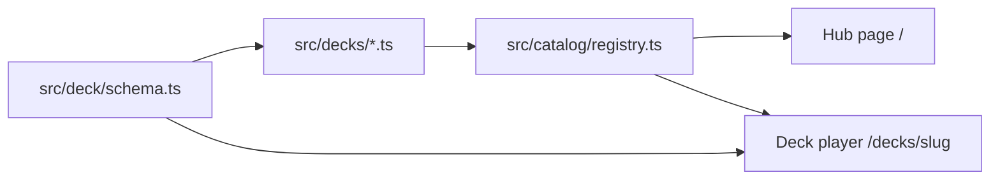

# Resource Hub context

## Architecture

Static Vite + React + TypeScript site. The hub is a catalog. Each sales deck is a typed `DeckData` module rendered by the shared deck player.

## Responsibilities

- `src/catalog/registry.ts` is the publish list. A deck appears on the hub only after it is registered. `published` entries are public to anyone who can open the site. `draft` entries render only in `npm run dev`.
- `src/pages/HubPage.tsx` is the catalog: a category list, one card per published deck, and one card per published link. Categories are declared in `catalogCategories`, so a category can appear before it has a deck. A category can set `parent` to appear as a subcategory. Games opens Instant Views and Roadmaps from a dropdown. A category `removeOn` date (`YYYY-MM-DD`) hides that category, its subcategories, and its decks on the visitor’s local calendar date and after. Blasts & Races uses `2027-06-01`. A clock beside that hub card opens a countdown to local midnight at the start of that date. The same countdown sits in the deck navigation bar and on the design-system board. The printed deck date is a label and does not remove the deck. The hub background uses the shared particle layer behind the catalog.
- `catalogLinks` publishes an external page as a hub card. The card opens that URL in a new tab. Instant Views lists every published item from the more.playson.com Instant Views collection. Roadmaps lists the published pages under Roadmaps / 2026. Draft items stay off the hub. Local development shows a Sync Instant Views and Roadmaps button. That button is omitted from the production build, so it does not appear on GitHub Pages.
- `src/deck/` is the player, slide schema, and templates shared by every deck.
- `src/decks/` holds deck content. Promo Tools, Blitz Mode, and Blasts & Races are published decks. Each registry entry is one hub card. Blasts & Races is a 13-page frame deck and leaves the catalog on 1 June 2027.
- A deck can supply `mobileSlides` and `mobileCanvas` when the mobile story is a different page sequence. `frame` slides are full-bleed page art with the shared particle layer. Glass cards on a frame can lift on hover, and coins on a frame can float above the art. Viewport changes keep the matching `pairId`.
- `src/pages/DesignSystemPage.tsx` is a local-development reference and is omitted from production builds. The Blasts & Races boards on that page use the same `2027-06-01` cutoff.

## Design decisions

- Decks are created in this repository and published by a catalog entry plus a git push. The hub does not fetch decks from other sites. A link card points at an already published page and does not copy that page into a deck.
- Routes are path-based (`/`, `/decks/<slug>`, `/design-system`) so GitHub Pages can serve them with the `404.html` copy of `index.html`. Pages publishes from the `Deploy resource hub` workflow to `https://mtheuma-cmd.github.io/playson-resource-hub/`.
- Slide deep links stay in the URL hash (`#slide=<id>`) so they survive player navigation without changing the deck path.
- Sales content is INTERNAL. Do not add customer data, unreleased metrics, or confidential commercial terms.

## Technology

Vite 7, React 19, TypeScript 5.9. No backend. No new runtime dependencies for the catalog.

## Environment

Node.js 20+. `npm run dev` serves `http://127.0.0.1:5173/`. `VITE_BASE` sets the GitHub Pages base path at build time.
